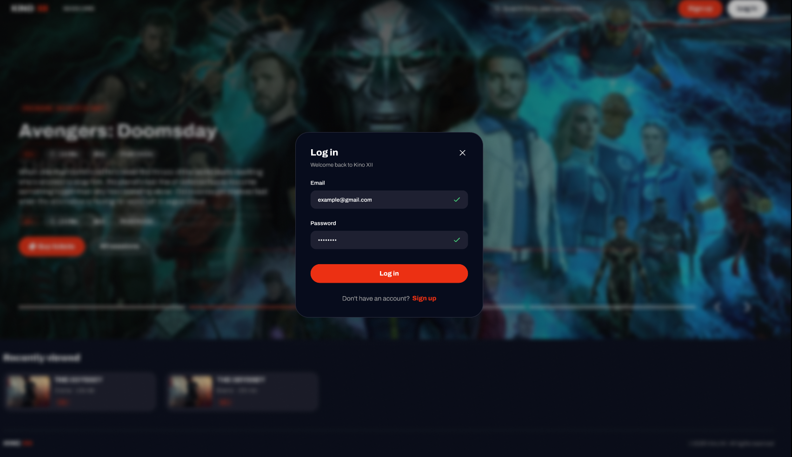
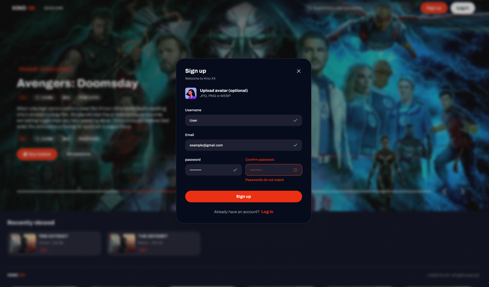
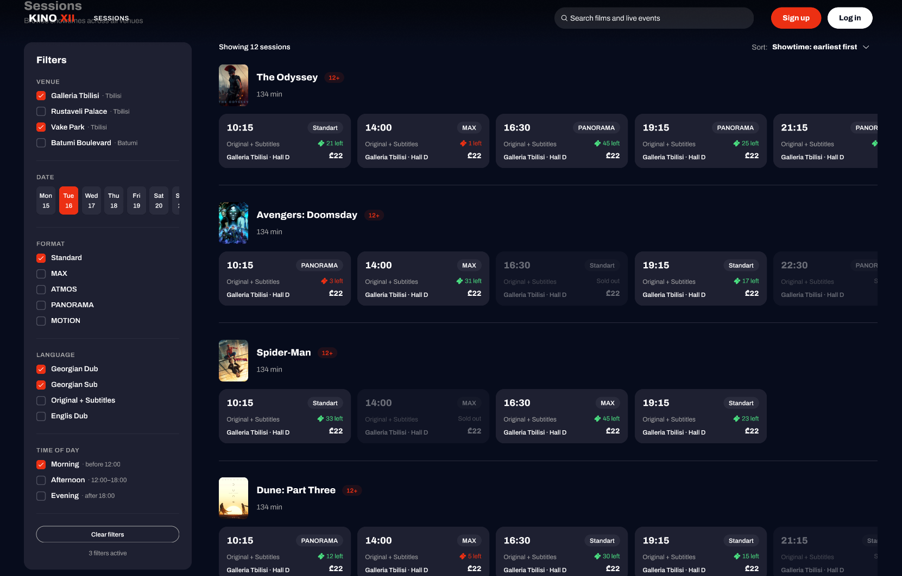

# Kino XII

Kino XII is a movie ticket booking web application developed as part of the Redberry Bootcamp XII frontend assignment.

The application was built using React and JavaScript, following the provided Figma design and integrating with the provided REST API.

## Design Preview

The following screenshots showcase the original design of Kino XII, which was used as the reference throughout frontend development.

### Homepage

.png)
.png)
.png)

### Login



### Signup



### Sessionspage




## Features

- **Movie Discovery** – Browse currently playing and upcoming movies.
- **Hero Carousel** – Explore featured movies through a rotating banner.
- **Movie Search** – Search for movies and display matching results.
- **Movie Sessions** – Explore available cinema sessions.
- **Filtering** – Filter movies and sessions using different criteria.
- **Authentication** – User registration and login.
- **Form Validation** – Client-side and server-side validation.
- **Avatar Upload** – Upload a profile avatar during registration.

## Technologies

- React
- JavaScript (ES6+)
- CSS
- REST API

## Project Status

Development was interrupted when the provided backend server became unavailable.

The application relies on API responses to display movie information, posters, cinema sessions, and other dynamic content. As a result, the backend's unavailability prevented further development and testing.

Although several pages and components had already been implemented according to the original design, the project remains incomplete because some functionality depends on the unavailable backend.

The repository is preserved in its current state, including the frontend implementation completed before the interruption.

## Getting Started

To run the project locally:

1. Clone the repository:

   ```bash
   git clone YOUR_REPOSITORY_URL
   ```

2. Navigate to the project directory:

   ```bash
   cd kino-XII
   ```

3. Install dependencies:

   ```bash
   npm install
   ```

4. Start the development server:

   ```bash
   npm run dev
   ```

**Note:** Movie-related sections require the original backend API to display their content.